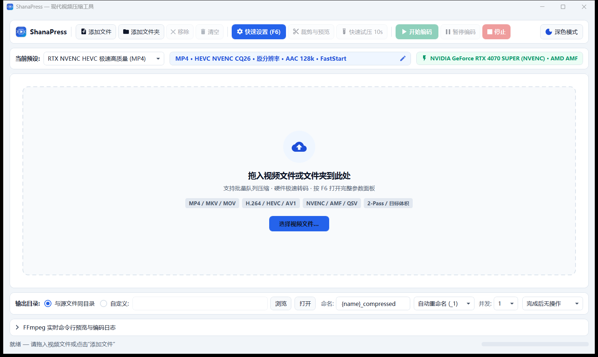

<div align="center">
  
  <h1>ShanaPress</h1>
  <p><strong>A Lightweight, Modern GPU-Accelerated Batch Video Compressor for Windows</strong></p>

  <p>
    
    
    
    
    
  </p>

  <p>
    <strong>English</strong> | <a href="README.zh-CN.md">简体中文</a>
  </p>
</div>

---

## Download & Install

Get the latest binaries from the [GitHub Releases page](https://github.com/LiangYu-ac/ShanaPress/releases/latest):

- **Windows Setup Installer (`ShanaPress-Setup-v*-win-x64.exe`, Recommended)**: Self-contained .NET 8 runtime and bundled `ffmpeg.exe` / `ffprobe.exe`, with Start Menu & Desktop shortcuts and standard Windows uninstall support — **ready to run out of the box**.
- **Portable Single-File (`ShanaPress-v*-win-x64-portable.exe`)**: Self-contained .NET 8 single executable (requires `ffmpeg.exe` and `ffprobe.exe` in `PATH` or alongside the executable).

---

## Screenshots

<table>
  <tr>
    <td align="center"><strong>Dark Mode</strong></td>
    <td align="center"><strong>Light Mode</strong></td>
  </tr>
  <tr>
    <td></td>
    <td></td>
  </tr>
</table>

---

## Key Features

### 1. Hardware Acceleration & Full Codec Support
- **NVIDIA NVENC**: Automatic probing for working `h264_nvenc`, `hevc_nvenc`, and `av1_nvenc`, supporting constant quality (`CQ`), VBR bitrate, single-pass `-multipass fullres`, and Spatial / Temporal AQ.
- **AMD AMF & Intel QSV**: Automatic detection and support for `h264_amf`, `hevc_amf`, `av1_amf`, and Intel Quick Sync Video encoders.
- **CPU Software Encoders**: `libx264`, `libx265`, `libaom-av1`, and `libvpx-vp9`, with CRF and true **2-Pass** encoding.
- **Lossless Remux & Utilities**: Direct video/audio stream copy (`Copy`), high-quality palette-optimized GIF export (`palettegen` / `paletteuse`), and audio-only extraction (MP3 / FLAC).

### 2. High-Efficiency Batch Workflow & Precise Size Control
- **Drag-and-Drop Queue**: Drop multiple video files or entire folders (scanned recursively) with concurrent `ffprobe` metadata analysis (resolution, FPS, codec, HDR status, audio & subtitle tracks).
- **Quick Settings Dialog (`F6`)**: Organized across 6 tabs (*Container & General*, *Video*, *Audio*, *Filters*, *Subtitles & Watermark*, *Presets & Advanced*) with a live FFmpeg CLI preview strip at the bottom.
- **Four Rate-Control Modes**:
  - `CRF / CQ` constant quality slider with quality tier guidance
  - `ABR` average bitrate
  - `2-Pass` two-pass bitrate encoding
  - **Target File Size (MB)**: Automatically calculates the target video bitrate from effective duration and audio bitrate
- **10-Second Sample Preview**: Encode a quick 10-second preview clip, inspect estimated full output size and compression ratio, and play the sample before encoding the entire batch.

### 3. Visual Trim, Crop & Video/Audio Filters
- **Visual Trim & Crop Editor**: Timeline scrubbing with debounced frame previews, proportional semi-transparent crop mask overlay, one-click **`cropdetect` black-bar auto-detection**, and per-file overrides for trim range and external subtitles.
- **Comprehensive Filter Pipeline**:
  - Rotation (90° / 180° / 270°), horizontal/vertical flip, and BWDIF / YADIF deinterlacing
  - **HDR → SDR Tone Mapping** (`zscale` + `tonemap` `hable` / `mobius` / `reinhard`) to prevent washed-out colors
  - Denoise (`hqdn3d`) and sharpen (`unsharp`)
  - Hardcoded SRT/ASS subtitle burn-in and soft subtitle muxing
  - Alpha-channel PNG image watermark (relative width scaling + opacity) and text watermark (`drawtext`)
  - Audio volume gain and EBU R128 loudness normalization (`loudnorm`)

### 4. Reliable Execution & Native Dark/Light Themes
- **1–4 Concurrent Jobs**, process-level **Pause / Resume** (suspends worker processes and freezes ETA tracking), and graceful **Stop / Cancel** (automatically cleans up partial output files and temporary 2-pass logs).
- **Full Dark & Light Themes**: Native Windows DWM title bar theming + custom control templates with instant switching.
- Custom preset management (save, overwrite, delete, JSON import/export) and post-encode actions (open output folder, chime, or 30s countdown shutdown).

---

## Built-in Presets

| Preset Name | Container | Video Encoder | Best For |
| --- | --- | --- | --- |
| RTX NVENC HEVC High Quality | MP4 | `hevc_nvenc` (CQ 26) | Fast NVIDIA compression balancing quality and size |
| RTX NVENC H.264 Universal | MP4 | `h264_nvenc` (CQ 24) | Maximum device compatibility with GPU speed |
| RTX NVENC AV1 Max Compression | MP4 | `av1_nvenc` (CQ 30) | Smallest files on RTX 40-series GPUs |
| CPU x264 Universal HQ | MP4 | `libx264` (CRF 23) | Broad compatibility across phones, web, and players |
| CPU x265 Archive | MKV | `libx265` (CRF 26) | High-efficiency archival compression |
| Social Share Compact (720p) | MP4 | `libx264` (720p 30fps) | Quick sharing with small file sizes |
| Target File Size 25MB (2-Pass) | MP4 | `libx264` (2-Pass) | Strict file-size cap workflows |
| Lossless Remux (Stream Copy) | MP4 | `copy` | Instant container change or lossless trim |
| Audio Extract Only | MP3 | `libmp3lame` (192k) | Extracting audio tracks from videos |
| High-Quality Animated GIF | GIF | `palettegen` / `paletteuse` | Crisp 15fps palette-optimized GIFs |

---

## Keyboard Shortcuts

- `F6`: Open **Quick Settings**
- `Ctrl + O`: Add video files
- `Delete` (when queue is focused): Remove selected items
- Double-click a queue row: Open **Trim & Crop Preview**

---

## Build from Source

### Prerequisites
- Windows 10 / Windows 11 (x64)
- [.NET 8 SDK](https://dotnet.microsoft.com/download/dotnet/8.0)
- `ffmpeg.exe` and `ffprobe.exe` (available in `PATH`, beside the executable, or configured under *Quick Settings → Presets & Advanced*)

### Build, Test & Package

```powershell
powershell -ExecutionPolicy Bypass -File build.ps1
```

This builds `ShanaPress.sln` in `Release` mode, runs all unit and real FFmpeg integration tests, and publishes `dist\ShanaPress.exe`.

Run only the dependency-free core unit tests (suitable for CI):

```powershell
dotnet run --project tests/ShanaPress.Tests/ShanaPress.Tests.csproj -c Release -- --unit-only
```

---

## Project Structure

```text
ShanaPress/
├── .github/workflows/
│   ├── build.yml                 # CI build & unit test workflow
│   └── release.yml               # Automated Windows installer & Release workflow
├── docs/                         # README logo & Dark/Light screenshots
├── installer/
│   └── ShanaPress.iss            # Inno Setup Windows installer script
├── src/
│   ├── ShanaPress.Core/          # Zero-dependency core library (models, HW probing, filters, CLI builder, runner)
│   └── ShanaPress.App/           # .NET 8 WPF desktop app (Dark/Light themes, DWM titlebar, MVVM views)
├── tests/
│   └── ShanaPress.Tests/         # Unit & FFmpeg/NVENC integration test suite
├── build.ps1                     # Local build, test & single-file publish script
├── LICENSE                       # MIT License
├── README.md                     # English documentation
├── README.zh-CN.md               # Simplified Chinese documentation
└── ShanaPress.sln
```

## License

Licensed under the [MIT License](LICENSE).
