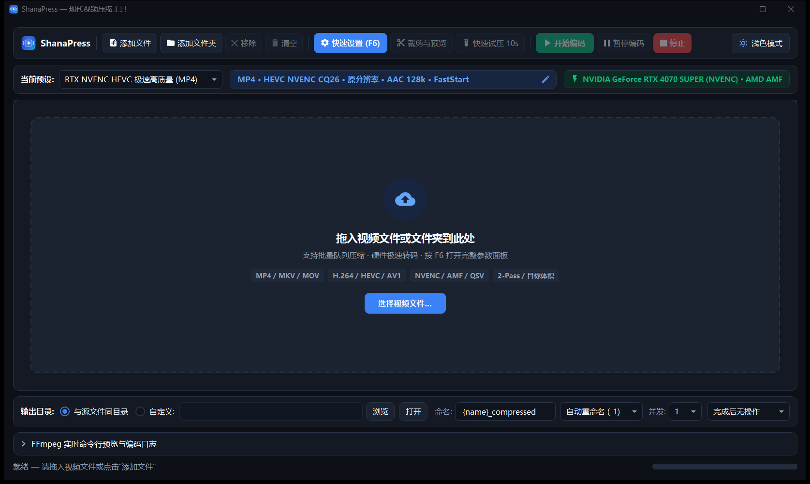

<div align="center">
  
  <h1>ShanaPress</h1>
  <p><strong>轻量级、现代化的 Windows GPU 批量视频压缩桌面工具</strong></p>

  <p>
    
    
    
    
    
  </p>
</div>

---

## 下载与安装

前往 [GitHub Releases 最新版本页面](https://github.com/LiangYu-ac/ShanaPress/releases/latest) 下载：

- **标准安装版 (`ShanaPress-Setup-v*-win-x64.exe`，推荐)**：内置 .NET 8 运行时与 FFmpeg 核心组件，支持安装向导、桌面快捷方式与常规卸载，**下载安装即可直接使用**。
- **绿色便携版 (`ShanaPress-v*-win-x64-portable.exe`)**：内置 .NET 8 运行时的单文件程序，无需安装即可运行（需在 `PATH` 或同级目录放置 `ffmpeg.exe` / `ffprobe.exe`）。

---

## 界面预览

<table>
  <tr>
    <td align="center"><strong>深色模式（Dark Mode）</strong></td>
    <td align="center"><strong>浅色模式（Light Mode）</strong></td>
  </tr>
  <tr>
    <td></td>
    <td></td>
  </tr>
</table>

---

## 核心特性

### 1. 硬件加速与全能编码器支持
- **NVIDIA NVENC**：自动探测 `h264_nvenc`、`hevc_nvenc`、`av1_nvenc`，支持 CQ 恒定质量、VBR 码率、`-multipass fullres` 与 Spatial / Temporal AQ。
- **AMD AMF & Intel QSV**：支持 `h264_amf`、`hevc_amf`、`av1_amf` 及 Quick Sync 硬件加速。
- **CPU 高画质软件编码**：`libx264`、`libx265`、`libaom-av1`、`libvpx-vp9`，支持 CRF 与完整 **2-Pass 二压**。
- **无损流复制与实用输出**：支持视频/音频流直接复制（`Copy`）、GIF 高清调色板导出、纯音频提取（MP3 / FLAC）。

### 2. 高效批量处理与精准控体积
- **拖拽批量队列**：支持一次拖入多个视频文件或整个文件夹（自动递归扫描），并发 `ffprobe` 解析分辨率、帧率、编码、HDR 状态与音轨/字幕信息。
- **快速设置面板 (`F6`)**：涵盖「封装与常规」「视频编码」「音频编码」「画面与滤镜」「字幕与水印」「预设与高级」六大选项卡，底部实时生成等效 FFmpeg 命令行。
- **四种码率控制模式**：
  - `CRF / CQ` 恒定质量滑块（实时画质分级提示）
  - `ABR` 平均码率
  - `2-Pass` 二压码率
  - **按目标体积 (MB)**：根据有效时长与音频码率自动反算视频码率，精准控制输出大小
- **10 秒快速试压预估**：截取片段试压并按比例预估完整输出体积与压缩率，支持试看确认后再启动整批编码。

### 3. 可视化区间裁剪、黑边裁切与滤镜增强
- **Trim & Crop 预览窗口**：时间轴滑块实时抽帧预览、可视化半透明裁切遮罩、`cropdetect` 一键自动检测黑边，并支持针对单个文件独立覆盖裁剪区间与外挂字幕。
- **完整画面与音频滤镜**：
  - 旋转（90° / 180° / 270°）、水平/垂直镜像、BWDIF / YADIF 去隔行
  - **HDR → SDR 色调映射**（`zscale` + `tonemap` `hable` / `mobius` / `reinhard`，避免 HDR 转 SDR 色彩发灰）
  - 降噪（`hqdn3d`）、锐化（`unsharp`）
  - SRT / ASS 外挂硬字幕烧录与软字幕封装
  - 透明通道 PNG 图片水印与中文文字水印（`drawtext`）
  - 音频音量增益与 EBU R128 响度标准化（`loudnorm`）

### 4. 可靠调度与原生深浅双主题
- 支持 **1 ~ 4 路并发编码**、进程级真暂停/继续（挂起/恢复编码进程并冻结 ETA 计时）、优雅取消（自动清理残缺文件与 2-Pass 临时日志）。
- **原生级深色 / 浅色模式**：支持 Windows 标题栏 DWM 沉浸着色与全控件定制模板，一键无刷新切换。
- 支持自定义预设保存、覆盖、删除及 JSON 导入/导出；支持编码完成后自动打开目录、提示音或 30 秒倒计时关机。

---

## 内置预设

| 预设名称 | 容器 | 视频编码器 | 适用场景 |
| --- | --- | --- | --- |
| RTX NVENC HEVC 极速高质量 | MP4 | `hevc_nvenc` (CQ 26) | NVIDIA 显卡极速压缩首选，体积与画质兼顾 |
| RTX NVENC H.264 极速通用 | MP4 | `h264_nvenc` (CQ 24) | 最高兼容性 + 硬件极速转码 |
| RTX NVENC AV1 极限压缩 | MP4 | `av1_nvenc` (CQ 30) | RTX 40 系显卡高压缩率首选 |
| CPU x264 通用兼容高画质 | MP4 | `libx264` (CRF 23) | 手机、网页与各类播放器通用兼容 |
| CPU x265 高压缩比存档 | MKV | `libx265` (CRF 26) | 高清视频高压缩比收藏存档 |
| 微信 / 社交分享小体积 | MP4 | `libx264` (720p 30fps) | 社交软件快速发送瘦身 |
| 按目标体积压缩 25MB | MP4 | `libx264` (2-Pass) | 严格控制输出体积上限 |
| 无损快速改封装 | MP4 | `copy` (Stream Copy) | 秒级换容器或无损裁剪 |
| 仅提取音频 | MP3 | `libmp3lame` (192k) | 从视频中剥离并导出音频 |
| 高清动态表情图 | GIF | `palettegen` / `paletteuse` | 15fps 调色板优化高清动图 |

---

## 快捷键

- `F6`：打开「快速设置」弹窗
- `Ctrl + O`：添加视频文件
- `Delete`（队列聚焦时）：移除选中任务
- 双击队列项：打开「裁剪与预览」窗口

---

## 快速开始与本地构建

### 运行环境
- Windows 10 / Windows 11 (x64)
- [.NET 8 Desktop Runtime](https://dotnet.microsoft.com/download/dotnet/8.0)（源码构建需 .NET 8 SDK）
- `ffmpeg.exe` 与 `ffprobe.exe`（位于系统 `PATH`、程序同级目录，或在「快速设置 → 预设与高级」中手动指定）

### 一键构建、测试与打包

```powershell
powershell -ExecutionPolicy Bypass -File build.ps1
```

脚本将依次执行 Release 编译、运行全量单元测试与 FFmpeg 集成测试，并输出单文件可执行程序 `dist\ShanaPress.exe`。

仅运行无外部依赖的核心单元测试（适用于 CI 环境）：

```powershell
dotnet run --project tests/ShanaPress.Tests/ShanaPress.Tests.csproj -c Release -- --unit-only
```

---

## 项目结构

```text
ShanaPress/
├── .github/workflows/build.yml   # GitHub Actions 自动构建与 CI 工作流
├── docs/                         # README 品牌图标与界面截图
├── src/
│   ├── ShanaPress.Core/          # 零第三方依赖核心库（模型、硬件探测、滤镜/命令构建、进度解析、进程控制）
│   └── ShanaPress.App/           # .NET 8 WPF 桌面应用（深浅双主题、DWM 标题栏、MVVM 视图）
├── tests/
│   └── ShanaPress.Tests/         # 单元测试与真实 FFmpeg/NVENC 集成测试套件
├── build.ps1                     # 一键编译、测试与单文件发布脚本
├── LICENSE                       # MIT 开源协议
└── ShanaPress.sln
```

## 开源协议

本项目基于 [MIT License](LICENSE) 开源。
