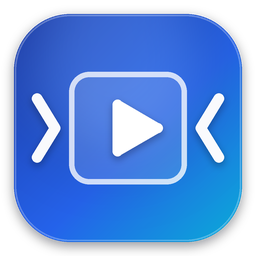

<div align="center">
  
  <h1>ShanaPress</h1>
  <p><strong>A Lightweight, Modern GPU-Accelerated Batch Video Compressor for Windows, macOS &amp; Linux</strong></p>

  <p>
    
    
    
    
    
  </p>

  <p>
    <strong>English</strong> | <a href="README.zh-CN.md">简体中文</a>
  </p>
</div>

---

## Download & Install

Get the latest builds from the [GitHub Releases page](https://github.com/LiangYu-ac/ShanaPress/releases/latest):

### Windows
- **Windows Setup Installer (`ShanaPress-Setup-v*-win-x64.exe`, Recommended)**: Native WPF build with self-contained .NET 8 runtime, bundled `ffmpeg.exe` / `ffprobe.exe`, Start Menu & Desktop shortcuts, and standard Windows uninstall support — **ready to run out of the box**.
- **Windows Portable Single-File (`ShanaPress-v*-win-x64-portable.exe`)**: Self-contained .NET 8 single executable (requires `ffmpeg.exe` and `ffprobe.exe` in `PATH` or alongside the executable).

### macOS
- **Apple Silicon (`ShanaPress-v*-macos-arm64.dmg`)** / **Intel (`ShanaPress-v*-macos-x64.dmg`)**: Avalonia cross-platform `.app` bundle. Open the `.dmg` and drag **ShanaPress** into `Applications`.
  - **FFmpeg Prerequisite**: Install FFmpeg via Homebrew before first run:
    ```bash
    brew install ffmpeg
    ```
  - **First Launch Note**: Releases are ad-hoc signed. If macOS Gatekeeper warns that the app is damaged or from an unidentified developer, clear the quarantine attribute once:
    ```bash
    sudo xattr -cr /Applications/ShanaPress.app
    ```

### Linux
- **Debian / Ubuntu (`ShanaPress-v*-linux-x64.deb`, Recommended)**: Automatically pulls `ffmpeg` via `apt` and installs desktop menu entry & icon:
  ```bash
  sudo apt install ./ShanaPress-v*-linux-x64.deb
  ```
- **Portable Tarball (`ShanaPress-v*-linux-x64.tar.gz` / `ShanaPress-v*-linux-arm64.tar.gz`)**: Extract anywhere and install `ffmpeg` (`sudo apt install ffmpeg`). Optionally run `./install-desktop.sh` from the extracted folder to register the desktop launcher.

---

## Key Features

### 1. Hardware Acceleration & Full Codec Support
- **NVIDIA NVENC** (Windows & Linux): Automatic probing for working `h264_nvenc`, `hevc_nvenc`, and `av1_nvenc`, supporting constant quality (`CQ`), VBR bitrate, single-pass `-multipass fullres`, and Spatial / Temporal AQ.
- **Apple VideoToolbox** (macOS): Native hardware encoding via `h264_videotoolbox` and `hevc_videotoolbox` (with QuickTime-compatible `-tag:v hvc1` and software fallback `-allow_sw 1`).
- **Linux VAAPI** (Intel / AMD on Linux): Automatic `/dev/dri/renderD128` device detection with `h264_vaapi`, `hevc_vaapi`, and `av1_vaapi`, appending `format=nv12,hwupload` cleanly to both simple and `-filter_complex` filter chains.
- **AMD AMF & Intel QSV**: Automatic detection and support for `h264_amf`, `hevc_amf`, `av1_amf`, and Intel Quick Sync Video (`*_qsv`) encoders.
- **Software Encoders & Containers**: `libx264`, `libx265`, `libsvtav1`, `libvpx-vp9`, Stream Copy (`copy`), animated **GIF** (2-pass `palettegen`/`paletteuse`), and audio-only **MP3 / AAC** extraction across `MP4`, `MKV`, `MOV`, `WebM`, `MP3`, and `GIF`.

### 2. Precise Rate Control & Pre-Encode Size Estimation
- **Four Rate Control Modes**: `CRF / CQ / QP` (Constant Quality), `Target File Size` (exact video bitrate calculation with optional 2-pass encoding), `1-Pass ABR`, and `2-Pass VBR`.
- **Sample Preview Size Estimator**: Encode a 5s / 10s / 20s segment first to preview actual image quality and accurately extrapolate the final compressed file size before running the full job.

### 3. Visual Trim, Crop & Video Filter Pipeline
- **Interactive Trim & Crop Dialog**: Frame-accurate timeline scrubbing with live preview thumbnails, Start/End trim markers, 4-edge pixel crop sliders, and one-click black-bar **Auto-Detect (`cropdetect`)**.
- **Video Filters**: `yadif` / `bwdif` deinterlacing, `90° / 180° / 270°` rotation, horizontal/vertical flip, resolution presets (`2160p` / `1080p` / `720p` / `480p` / custom scale), FPS control, HDR-to-SDR tone mapping, and light/medium/strong denoise & sharpen filters.
- **Subtitles & Watermarks**: Keep soft subtitles, burn in external `.srt` / `.ass` / `.vtt` subtitles (auto-resolving system CJK fonts on Windows, macOS, and Linux), remove subtitles, and overlay custom text or transparent PNG watermarks cleanly via `-filter_complex`.

### 4. Efficient Batch Queue & Modern Dark / Light UI
- **Cross-Platform UI**: Native WPF desktop app on Windows and matching Avalonia 11 UI on macOS & Linux — unified semantic **Dark** and **Light** themes, responsive layout, custom vector icon, and full drag-and-drop file/folder import.
- **Process Control**: True job **Pause / Resume** (`NtSuspendProcess` / `NtResumeProcess` on Windows; `SIGSTOP` / `SIGCONT` on macOS & Linux), safe input/output collision guards, custom output templates (`{name}_compressed`, `{codec}`, `{preset}`), completion notifications, and optional auto-shutdown on completion.

---

## Built-in Presets

| Preset Name | Target Scenario | Codec & Parameters |
| --- | --- | --- |
| **Apple VideoToolbox HEVC Hardware (MP4)** *(macOS default)* | High-efficiency compression on Apple Silicon / Intel Mac | `hevc_videotoolbox` · Q `25` (`-q:v 59`) · `hvc1` · AAC 128k |
| **Apple VideoToolbox H.264 Fast Universal (MP4)** | Maximum compatibility on macOS & older devices | `h264_videotoolbox` · Q `23` (`-q:v 62`) · AAC 128k |
| **RTX HEVC High-Efficiency (NVENC)** | General high-compression storage on NVIDIA GPUs | `hevc_nvenc` · CQ `28` · Preset `p5` · AAC 128k |
| **Linux VAAPI HEVC Hardware** | Hardware encoding for Intel / AMD GPUs on Linux | `hevc_vaapi` · QP `26` · `/dev/dri/renderD128` · AAC 128k |
| **RTX H.264 High-Compatibility (NVENC)** | Cross-device playback (WeChat / mobile / web) | `h264_nvenc` · CQ `24` · Preset `p5` · AAC 128k |
| **RTX AV1 Extreme Compression (NVENC)** | RTX 40/50 series smallest size for high quality | `av1_nvenc` · CQ `32` · Preset `p5` · Opus/AAC |
| **Social / Upload 25MB Cap** | Discord / WeChat / email strict file-size limits | Target Size `23 MB` · 2-Pass · 720p |
| **Screen Recording Ultra-Light (x264)** | Clean screen captures & tutorials | `libx264` · CRF `24` · Preset `medium` |
| **Web Optimized (WebM VP9)** | Web playback with open codecs | `libvpx-vp9` · CRF `32` · Opus 128k |
| **High-Compression Archive (x265)** | Archival quality without GPU dependency | `libx265` · CRF `24` · Preset `medium` |
| **SVT-AV1 Next-Gen CPU** | High-efficiency software AV1 encoding | `libsvtav1` · CRF `34` · Preset `6` |
| **Extract Audio (MP3 192k)** | Audio track extraction from videos | `-vn` · `libmp3lame` · 192k MP3 |
| **Animated GIF (15fps)** | Crisp looping GIFs with optimized color palette | 2-pass `palettegen` + `paletteuse` |

---

## Build from Source

### Prerequisites
- [.NET 8.0 SDK](https://dotnet.microsoft.com/download/dotnet/8.0)
- `ffmpeg` and `ffprobe` in `PATH` (or alongside the app binary; optional on build machine if using `--unit-only` tests)
- *(Windows Release Installer only)*: [Inno Setup 6](https://jrsoftware.org/isinfo.php)

### Build & Run
```bash
git clone https://github.com/LiangYu-ac/ShanaPress.git
cd ShanaPress

# Build full solution (Core + Desktop on Linux/macOS; + WPF App on Windows)
dotnet build ShanaPress.sln -c Release

# Run the Cross-Platform Avalonia Desktop App (Windows, macOS & Linux)
dotnet run --project src/ShanaPress.Desktop/ShanaPress.Desktop.csproj -c Release

# Run the Native Windows WPF App (Windows only)
dotnet run --project src/ShanaPress.App/ShanaPress.App.csproj -c Release
```

### Run Automated Tests
```bash
# Run cross-platform unit tests (no FFmpeg required)
dotnet run --project tests/ShanaPress.Tests/ShanaPress.Tests.csproj -c Release -- --unit-only

# Run full suite including live FFmpeg + NVENC integration tests
dotnet run --project tests/ShanaPress.Tests/ShanaPress.Tests.csproj -c Release
```

---

## Project Structure

```text
├── src/
│   ├── ShanaPress.Core/       # Cross-platform FFmpeg command/filter builder, hardware probing, process runner, presets
│   ├── ShanaPress.App/        # Windows WPF UI (MVVM), Dark/Light themes, vector branding
│   └── ShanaPress.Desktop/    # Cross-platform Avalonia 11 UI (Windows, macOS & Linux)
├── tests/
│   └── ShanaPress.Tests/      # Unit tests + live FFmpeg & hardware integration test suite
├── installer/
│   └── ShanaPress.iss         # Inno Setup script bundling Windows app + .NET 8 + FFmpeg
├── packaging/
│   ├── macos/Info.plist       # macOS .app bundle metadata
│   └── linux/                 # .deb builder, .desktop launcher, and helper install script
└── .github/workflows/
    ├── build.yml              # CI build + unit tests across Windows, macOS, and Linux
    └── release.yml            # Multi-OS release pipeline publishing Setup .exe, .dmg, .deb & .tar.gz
```

---

## License

This project is licensed under the [MIT License](LICENSE).
