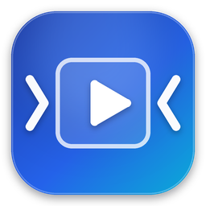

<div align="center">
  
  <h1>ShanaPress</h1>
  <p><strong>轻量、高颜值的跨平台 GPU 加速批量视频压缩工具（Windows / macOS / Linux）</strong></p>

  <p>
    
    
    
    
    
  </p>

  <p>
    <a href="README.md">English</a> | <strong>简体中文</strong>
  </p>
</div>

---

## 下载与安装

前往 [GitHub Releases 页面](https://github.com/LiangYu-ac/ShanaPress/releases/latest) 下载对应系统版本：

### Windows
- **Windows 安装版（`ShanaPress-Setup-v*-win-x64.exe`，推荐）**：原生 WPF 版本，内置完整 .NET 8 运行环境及 `ffmpeg.exe` / `ffprobe.exe`，提供标准安装向导、开始菜单与桌面快捷方式，支持控制面板卸载——**下载安装即可开箱即用**。
- **Windows 单文件绿色版（`ShanaPress-v*-win-x64-portable.exe`）**：独立可执行的 .NET 8 单文件程序（需系统 `PATH` 或程序同目录下存在 `ffmpeg.exe` 与 `ffprobe.exe`）。

### macOS
- **Apple Silicon 芯片（`ShanaPress-v*-macos-arm64.dmg`）** / **Intel 芯片（`ShanaPress-v*-macos-x64.dmg`）**：基于 Avalonia 的原生 `.app` 镜像包。双击打开 `.dmg` 后将 **ShanaPress** 拖入 `应用程序 (Applications)` 即可。
  - **安装 FFmpeg 依赖**：首次运行前通过 Homebrew 安装 FFmpeg：
    ```bash
    brew install ffmpeg
    ```
  - **首次打开提示说明**：安装包使用 Ad-hoc 自签名。若 macOS 提示“无法验证开发者”或“文件已损坏”，请在终端执行一次以下命令移除隔离属性：
    ```bash
    sudo xattr -cr /Applications/ShanaPress.app
    ```

### Linux
- **Debian / Ubuntu 安装包（`ShanaPress-v*-linux-x64.deb`，推荐）**：自动声明并安装 `ffmpeg` 依赖，并注册应用菜单图标：
  ```bash
  sudo apt install ./ShanaPress-v*-linux-x64.deb
  ```
- **通用压缩包（`ShanaPress-v*-linux-x64.tar.gz` / `ShanaPress-v*-linux-arm64.tar.gz`）**：解压即用（需提前安装 FFmpeg，如 `sudo apt install ffmpeg`），可运行解压目录内的 `./install-desktop.sh` 注册桌面快捷方式。

---

## 核心特性

### 1. 全硬件加速与丰富编码器支持
- **NVIDIA NVENC**（Windows & Linux）：启动自动真实探测可用的 `h264_nvenc`、`hevc_nvenc`、`av1_nvenc`，支持恒定质量 (`CQ`)、VBR 码率、单次高精度 `-multipass fullres` 及 Spatial / Temporal AQ。
- **Apple VideoToolbox**（macOS）：原生硬件加速支持 `h264_videotoolbox` 与 `hevc_videotoolbox`（自动附加 QuickTime 兼容的 `-tag:v hvc1` 及软件回退 `-allow_sw 1`）。
- **Linux VAAPI**（Linux 平台 Intel / AMD 核显独显）：自动探测 `/dev/dri/renderD128` 设备，支持 `h264_vaapi`、`hevc_vaapi`、`av1_vaapi`，自动在简单滤镜及 `-filter_complex` 水印链末尾注入 `format=nv12,hwupload`。
- **AMD AMF & Intel QSV**：自动探测并支持 `h264_amf`、`hevc_amf`、`av1_amf` 与 Intel Quick Sync Video (`*_qsv`) 编码器。
- **软件编码与无损容器**：支持 `libx264`、`libx265`、`libsvtav1`、`libvpx-vp9`、流复制 (`copy`)、双通道调色板高清 **GIF** 导出、纯音频提取（MP3 / AAC），支持 `MP4` / `MKV` / `MOV` / `WebM` / `MP3` / `GIF` 等容器。

### 2. 精准码率控制与压前大小预测
- **四种码控模式**：支持 `CRF / CQ / QP` 恒定质量、`指定目标体积`（按时长精确反算码率并可选 2-Pass 二次编码）、`1-Pass ABR` 与 `2-Pass VBR`。
- **样本预览大小预估**：正式压缩前可一键试压 `5秒 / 10秒 / 20秒` 片段，直观检查画质并高准确度推算完整文件压缩后体积。

### 3. 可视化裁剪、画面滤镜与字幕水印
- **可视化剪辑与裁剪弹窗**：实时拖动进度条并抽帧预览，支持可视化设置起止剪辑时间点、四边像素裁剪滑块，以及一键黑边**自动探测 (`cropdetect`)**。
- **画面滤镜管道**：支持 `yadif` / `bwdif` 去隔行、`90° / 180° / 270°` 旋转、水平/垂直翻转、常用分辨率缩放、帧率调整、HDR 转 SDR 色调映射以及轻/中/强三档降噪与锐化。
- **字幕与水印**：支持保留软字幕、外挂 `.srt` / `.ass` / `.vtt` 硬字幕烧录（自动定位 Windows / macOS / Linux 中文字体）、清除字幕；支持文字水印与透明 PNG 图片水印混合叠加。

### 4. 高效批量队列与深浅双主题界面
- **跨平台现代桌面界面**：Windows 采用原生 WPF，macOS 与 Linux 采用布局与配色一致的 Avalonia 11 桌面 UI——统一语义化**深色 (Dark)** / **浅色 (Light)** 主题、自定义矢量图标、完整支持文件与文件夹拖拽导入。
- **实用批处理控制**：原生进程**暂停 / 恢复**（Windows 使用 `NtSuspendProcess` / `NtResumeProcess`，macOS & Linux 使用 `SIGSTOP` / `SIGCONT`）、同路径防覆盖安全保护、自定义输出文件名模板、任务完成桌面通知及跨平台完成后自动关机选项。

---

## 内置预设一览

| 预设名称 | 适用场景 | 核心参数 |
| --- | --- | --- |
| **Apple VideoToolbox HEVC 高效压制 (MP4)** *(macOS 默认)* | Apple Silicon / Intel Mac 高速省空间压制 | `hevc_videotoolbox` · 质量 `25` (`-q:v 59`) · `hvc1` · AAC 128k |
| **Apple VideoToolbox H.264 极速通用 (MP4)** | macOS 下高兼容性导出与快速分享 | `h264_videotoolbox` · 质量 `23` (`-q:v 62`) · AAC 128k |
| **RTX HEVC 高效压缩 (NVENC)** | 日常高压缩比存档、体积小画质高 | `hevc_nvenc` · CQ `28` · Preset `p5` · AAC 128k |
| **Linux VAAPI HEVC 硬件压制** | Linux 下 Intel / AMD GPU 硬件压制 | `hevc_vaapi` · QP `26` · `/dev/dri/renderD128` · AAC 128k |
| **RTX H.264 高兼容分享 (NVENC)** | 微信 / 手机端 / 网页端全设备秒播 | `h264_nvenc` · CQ `24` · Preset `p5` · AAC 128k |
| **RTX AV1 极致压缩 (NVENC)** | RTX 40/50 系显卡最小体积压制 | `av1_nvenc` · CQ `32` · Preset `p5` · Opus/AAC |
| **社交上传 25MB 限制** | Discord / 微信 / 邮件严格限流上传 | 目标体积 `23 MB` · 2-Pass · 720p |
| **录屏课件超轻压缩 (x264)** | 高清录屏、教程演示低码率高清晰 | `libx264` · CRF `24` · Preset `medium` |
| **网页优化 (WebM VP9)** | 网页内嵌开源免版税高清播放 | `libvpx-vp9` · CRF `32` · Opus 128k |
| **高压缩归档 (x265)** | 不依赖独显的纯净 CPU 极致收藏画质 | `libx265` · CRF `24` · Preset `medium` |
| **SVT-AV1 极速高压缩 (CPU)** | 新一代开源高效 AV1 软件压制 | `libsvtav1` · CRF `34` · Preset `6` |
| **仅提取音频 (MP3 192k)** | 快速剥离视频并输出高品质 MP3 | `-vn` · `libmp3lame` · 192k MP3 |
| **高清动态表情图 (GIF 15fps)** | 双通道调色板优化输出清晰流畅动图 | `palettegen` + `paletteuse` |

---

## 从源码构建

### 环境要求
- [.NET 8.0 SDK](https://dotnet.microsoft.com/download/dotnet/8.0)
- 系统 `PATH`（或运行目录）下已配置 `ffmpeg` 与 `ffprobe`（若仅运行单元测试 `--unit-only` 可不安装）
- *（仅生成 Windows `.exe` 安装包时需要）*：[Inno Setup 6](https://jrsoftware.org/isinfo.php)

### 编译与运行
```bash
git clone https://github.com/LiangYu-ac/ShanaPress.git
cd ShanaPress

# 编译整个解决方案（Linux/macOS 自动跳过 Windows WPF 项目并编译 Core + Desktop + Tests）
dotnet build ShanaPress.sln -c Release

# 运行跨平台 Avalonia 桌面端（Windows / macOS / Linux）
dotnet run --project src/ShanaPress.Desktop/ShanaPress.Desktop.csproj -c Release

# 运行 Windows 原生 WPF 桌面端（仅 Windows）
dotnet run --project src/ShanaPress.App/ShanaPress.App.csproj -c Release
```

### 运行自动化测试
```bash
# 运行跨平台单元测试（无需 FFmpeg）
dotnet run --project tests/ShanaPress.Tests/ShanaPress.Tests.csproj -c Release -- --unit-only

# 运行包含真实 FFmpeg 与硬件编码器在内的完整测试套件
dotnet run --project tests/ShanaPress.Tests/ShanaPress.Tests.csproj -c Release
```

---

## 项目结构

```text
├── src/
│   ├── ShanaPress.Core/       # 跨平台 FFmpeg 命令与滤镜构建、硬件探测、进程控制与预设仓库
│   ├── ShanaPress.App/        # Windows 原生 WPF 界面（MVVM）、深浅色主题与矢量品牌图标
│   └── ShanaPress.Desktop/    # 跨平台 Avalonia 11 桌面界面（Windows / macOS / Linux）
├── tests/
│   └── ShanaPress.Tests/      # 单元测试 + 真实 FFmpeg / NVENC 集成测试套件
├── installer/
│   └── ShanaPress.iss         # Windows Inno Setup 安装包配置（内嵌 .NET 8 与 FFmpeg）
├── packaging/
│   ├── macos/Info.plist       # macOS .app 应用包描述文件
│   └── linux/                 # .deb 构建脚本、.desktop 启动器与桌面注册脚本
└── .github/workflows/
    ├── build.yml              # Windows / macOS / Linux 三平台 CI 构建与单元测试
    └── release.yml            # 多平台自动化发布流水线（输出安装包、.dmg、.deb 与 .tar.gz）
```

---

## 开源协议

本项目基于 [MIT License](LICENSE) 开源。
